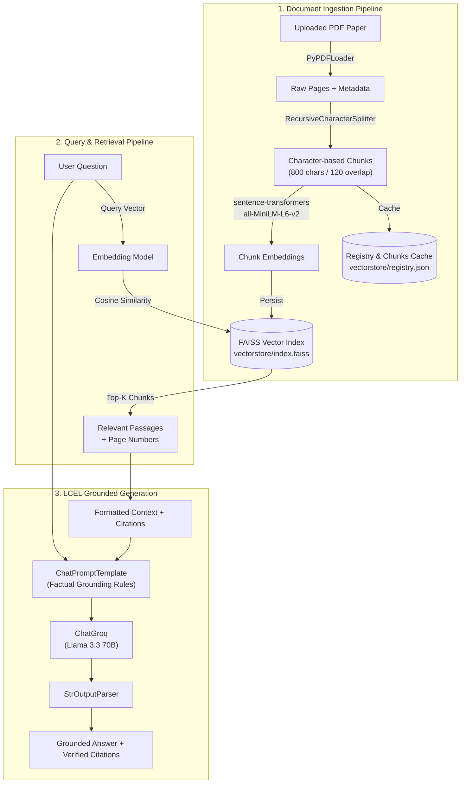

# ResearchMate AI — Research PDF RAG Assistant

> An evidence-based, retrieval-augmented scientific paper assistant built with **Flask**, **LangChain (LCEL)**, **FAISS**, local **Sentence-Transformers**, and the high-speed **Groq API**.

---

## Table of Contents
1. [Project Overview](#project-overview)
2. [Key Features](#key-features)
3. [Architecture Overview](#architecture-overview)
4. [Technology Stack](#technology-stack)
5. [Project Structure](#project-structure)
6. [Quickstart & Installation (Windows PowerShell)](#quickstart--installation-windows-powershell)
7. [Groq API Configuration](#groq-api-configuration)
8. [Running the Application](#running-the-application)
9. [Running Automated Tests](#running-automated-tests)
10. [The Beginner's Guide to RAG (Concepts Explained)](#the-beginners-guide-to-rag-concepts-explained)
    - [1. What RAG means](#1-what-rag-means)
    - [2. What LangChain does](#2-what-langchain-does)
    - [3. What Groq does](#3-what-groq-does)
    - [4. Why embeddings are needed](#4-why-embeddings-are-needed)
    - [5. How FAISS works](#5-how-faiss-works)
    - [6. How the retriever finds chunks](#6-how-the-retriever-finds-chunks)
    - [7. How LCEL connects the pipeline](#7-how-lcel-connects-the-pipeline)
    - [8. How citations reach the frontend](#8-how-citations-reach-the-frontend)
    - [9. How Flask connects HTML/CSS to Python](#9-how-flask-connects-htmlcss-to-python)
    - [10. How to debug poor retrieval](#10-how-to-debug-poor-retrieval)
11. [Troubleshooting & Common Errors](#troubleshooting--common-errors)
12. [Security, Limitations & Production Considerations](#security-limitations--production-considerations)

---

## Project Overview

**ResearchMate AI** is designed specifically for students, researchers, and engineers who need to read and understand complex scientific publications quickly without hallucinations.

Unlike standard chatbots that attempt to answer questions from generic pre-trained memory, ResearchMate AI uses **genuine Retrieval-Augmented Generation (RAG)**:
1. It ingests your PDF research papers.
2. Extracts and slices text into semantic chunks.
3. Computes vector embeddings locally on your machine.
4. Indexes them using a local FAISS vector store.
5. Pulls top relevant passages and feeds them into **Groq's Llama 3.3 70B** model.
6. Returns factually grounded answers accompanied by verifiable **PDF filenames, 1-based page numbers, and supporting text excerpts**.

---

## Key Features

- **Genuine Grounded RAG**: Strict prompt rules and algorithmic retrieval guarantee that answers cite the uploaded research rather than general speculation.
- **100% Free Local Embeddings**: Uses `sentence-transformers/all-MiniLM-L6-v2` locally on CPU. No separate OpenAI or embedding API key is required.
- **Ultra-Fast Generation**: Powered by Groq's LPU Inference Engine (`llama-3.3-70b-versatile` or `llama-3.1-8b-instant`).
- **Verified Source Citations**: Every answer provides an expandable source tray displaying the exact PDF name, 1-based page number, and source passage.
- **8-Part Structured Summaries**: Click "Summarize" on any paper to automatically extract:
  1. Research Objective
  2. Problem Statement
  3. Proposed Methodology
  4. Dataset
  5. Experimental Setup
  6. Reported Results
  7. Limitations
  8. Future Work
- **Conversational Memory**: Supports follow-up questions (e.g., *"What about its limitations?"*) while retrieving new evidence for each turn.
- **Knowledge Base Management**: Add papers, list indexed documents, and delete papers with automated FAISS index rebuilding.
- **Zero Frontend Frameworks**: Built using pure HTML5, vanilla CSS3, and browser-native JavaScript.

---

## Architecture Overview



---

## Technology Stack

- **Language**: Python 3.12+
- **Backend Framework**: Flask 3.1.3
- **RAG Orchestration**: LangChain 1.4+, LangChain Core, LangChain Groq, LangChain Text Splitters
- **Embeddings**: `sentence-transformers` (`all-MiniLM-L6-v2` via `langchain-huggingface`)
- **Vector Database**: `faiss-cpu` (Facebook AI Similarity Search)
- **PDF Extraction**: `pypdf`
- **Inference LLM**: Groq Cloud API (`llama-3.3-70b-versatile`)
- **Frontend**: Vanilla HTML5, Modern CSS3 (Inter font, responsive flex/grid), Vanilla JavaScript (Fetch API)
- **Testing**: `pytest`

---

## Project Structure

```
researchmate-ai/
│
├── app.py                 # Flask web application, routes, file uploads, session state
├── rag.py                 # Core RAG pipeline: PDF parsing, chunking, embeddings, FAISS, LCEL Groq chain
├── requirements.txt       # Production dependencies
├── pytest.ini             # Pytest discovery configuration
├── .env                   # Local environment variables (API keys, models, chunk parameters)
├── .env.example           # Safe template for environment configuration
├── .gitignore             # Git exclusions (virtualenvs, secrets, cache, user uploads)
├── README.md              # Complete guide and conceptual tutorial
│
├── templates/
│   └── index.html         # Modern single-page web UI
│
├── static/
│   └── style.css          # Custom responsive CSS design system
│
├── uploads/               # Local staging directory for uploaded PDF papers
│   └── .gitkeep
│
├── vectorstore/           # Local storage for FAISS index and document registry
│   └── .gitkeep
│
└── tests/
    └── test_app.py        # Comprehensive unit & integration test suite (9 test cases)
```

---

## Quickstart & Installation (Windows PowerShell)

Open PowerShell in your workspace directory (`e:\RAG\RESEARCHMATE`):

### 1. Create and Activate Virtual Environment
```powershell
python -m venv .venv
.\.venv\Scripts\Activate.ps1
```

*(If PowerShell displays an execution policy error, enable local script execution with `Set-ExecutionPolicy -Scope Process -ExecutionPolicy Bypass`)*

### 2. Install Required Dependencies
```powershell
pip install -r requirements.txt
```

---

## Groq API Configuration

1. Visit the [Groq Console](https://console.groq.com) and create a free account.
2. Navigate to **API Keys** and generate a new key (starts with `gsk_...`).
3. Copy `.env.example` to `.env`:
```powershell
Copy-Item .env.example .env
```
4. Open `.env` and paste your API key:
```env
GROQ_API_KEY=gsk_your_actual_key_here
GROQ_MODEL=llama-3.3-70b-versatile
CHUNK_SIZE=800
CHUNK_OVERLAP=120
TOP_K=4
```

> **Note**: If `GROQ_API_KEY` is omitted, the web application still runs safely, allowing document uploads and offline unit tests to pass while clearly prompting you when chat questions are submitted.

---

## Running the Application

With your `.venv` activated:

```powershell
python app.py
```

Open your browser and navigate to:
```
http://127.0.0.1:5000
```

### Usage Steps:
1. **Upload**: Drag and drop a scientific PDF or click **Choose or Drop PDF** in the sidebar.
2. **Review**: The paper will appear in the sidebar with page count and chunk count.
3. **Ask**: Type a research question in the input box (e.g., *"What is the main contribution of this paper?"*) or click any sample prompt.
4. **Inspect Citations**: Click **"▶ Verified Supporting Passages"** below any AI response to inspect the exact PDF excerpt and page number used to formulate the answer.
5. **Summarize**: Click the **📋 Summarize** button next to any paper in the sidebar to generate a structured 8-part breakdown.

---

## Running Automated Tests

Run the test suite using pytest:

```powershell
pytest -v
```

All 9 test cases validate:
- Flask homepage routing
- Missing question validation
- Missing API key detection
- Rejection of invalid non-PDF file formats
- Blank PDF and scanned document OCR warnings
- 0-based to 1-based human display page conversions
- Chunk metadata preservation (`document_name`, `page`, `display_page`, `chunk_id`)
- Local FAISS index persistence, top-k retrieval, and clean document deletion
- Mocked Groq LCEL generation and source passage formatting

---

## The Beginner's Guide to RAG (Concepts Explained)

### 1. What RAG means
**RAG** stands for **Retrieval-Augmented Generation**. 

Large Language Models (LLMs) like Llama 3 or GPT-4 only know information from their pre-training training data cutoff. If you ask an LLM about a brand-new scientific paper published last week, it will either guess or make things up (hallucination).

Instead of fine-tuning the model (which is slow, expensive, and inflexible), RAG solves this in 3 steps:
1. **Retrieve**: Search your uploaded PDFs for the 3–5 most relevant paragraphs.
2. **Augment**: Paste those paragraphs into the prompt alongside the user's question as explicit context.
3. **Generate**: Ask the LLM to write an answer using *only* the retrieved context.

In `rag.py`, this happens in `ask_question()`:
```python
retrieved_docs = retriever.invoke(search_query)
context_str, sources = format_documents(retrieved_docs)
answer = chain.invoke({"context": context_str, "question": question, ...})
```

---

### 2. What LangChain does
**LangChain** is an open-source framework that provides modular building blocks for AI applications. Instead of writing custom string manipulation, vector math, and HTTP wrappers from scratch, LangChain provides standardized interfaces:
- `PyPDFLoader`: Reads PDF pages and metadata.
- `RecursiveCharacterTextSplitter`: Splits text intelligently.
- `FAISS`: Manages vector similarity math.
- `ChatGroq`: Communicates with Groq's high-speed API.

---

### 3. What Groq does
**Groq** is an AI infrastructure provider that developed the **LPU (Language Processing Unit)**—custom silicon designed specifically for executing transformer models at 300 to 500+ tokens per second.

In ResearchMate AI, Groq generates the natural-language explanations from the retrieved context. Because Groq's response latency is mere fractions of a second, users experience near-instant research synthesis.

---

### 4. Why embeddings are needed
Computers cannot compare text by meaning using regular keyword search alone. For example, the phrases:
- *"Convolutional feature maps"*
- *"Spatial visual representations"*

share zero common words, but mean nearly the same thing in computer vision.

An **embedding model** (like `sentence-transformers/all-MiniLM-L6-v2`) converts text into a list of 384 floating-point numbers (a vector). Chunks that discuss similar concepts end up closer together in mathematical vector space (measured by Cosine Similarity).

---

### 5. How FAISS works
**FAISS** (**F**acebook **A**I **S**imilarity **S**earch) is a library written in C++ with Python bindings. When you have hundreds or thousands of document chunks, comparing your search question vector against every single chunk individually can be slow. 

FAISS creates an efficient memory index (`index.faiss`) that indexes vectors so that the closest nearest neighbors can be found in milliseconds. In ResearchMate AI, the index is saved locally in the `vectorstore/` folder.

---

### 6. How the retriever finds chunks
When you call `retriever.invoke(question)`:
1. The question string is passed through `create_embeddings()`, producing a 384-dimensional query vector.
2. FAISS compares the query vector against all chunk vectors in the index using normalized inner product (cosine similarity).
3. The top `k` chunks (configured by `TOP_K=4` in `.env`) with the highest similarity scores are returned as LangChain `Document` objects.

---

### 7. How LCEL connects the pipeline
**LCEL** stands for **LangChain Expression Language**. It uses Python's pipe operator (`|`) to compose pipelines cleanly:

```python
chain = prompt | llm | StrOutputParser()
```

This reads naturally:
1. The `prompt` dictionary produces formatted messages.
2. The messages are piped into the `llm` (ChatGroq).
3. The raw model output is piped into `StrOutputParser()`, which strips out raw response objects and returns clean text.

---

### 8. How citations reach the frontend
To guarantee that citations are 100% genuine and not hallucinated:
1. In `rag.py`, `format_documents()` attaches a numeric source label (e.g., `[Source 1]`) to each retrieved chunk.
2. The zero-based PDF page index is converted to a 1-based page number (`page + 1`) exactly once:
   ```python
   display_page = page_num + 1
   ```
3. `ask_question()` returns both the LLM's text answer **and** a verified list of source dictionaries:
   ```json
   {
     "answer": "...",
     "sources": [
       {"id": 1, "document": "paper.pdf", "page": 3, "text": "..."}
     ]
   }
   ```
4. The JavaScript frontend (`templates/index.html`) renders the answer, accompanied by an interactive expandable drawer that presents the exact excerpt and page number.

---

### 9. How Flask connects HTML/CSS to Python
- **Flask** acts as the web server bridge:
  - When the user visits `http://127.0.0.1:5000/`, Flask calls `index()` in `app.py` and renders `templates/index.html`.
  - When the user uploads a file, the browser's JavaScript makes a `POST /upload` request with the PDF binary. Flask saves the file in `uploads/` and calls `rag.load_pdf()`.
  - When the user types a question, JavaScript sends a JSON request to `POST /chat`. Flask forwards the question to `rag.ask_question()`, receives the answer and sources, and sends back a JSON response.

---

### 10. How to debug poor retrieval
If ResearchMate AI says *"I could not find sufficient evidence in the uploaded research papers"*:
1. **Check chunk size (`CHUNK_SIZE`)**: If chunks are too small (e.g., 200 characters), sentences may be split in half, destroying semantic context. The default 800 characters works best for scientific papers.
2. **Check chunk overlap (`CHUNK_OVERLAP`)**: 120 characters ensures thoughts spanning chunk boundaries are not lost.
3. **Inspect Top-K (`TOP_K`)**: If a paper is 40 pages long, `TOP_K=4` might only retrieve 4 paragraphs. Increase `TOP_K=6` or `8` in `.env` to give the model more context.
4. **Scanned PDFs**: If a PDF is a scanned image without a native text layer, `PyPDFLoader` will extract empty strings. ResearchMate AI alerts you if an OCR step is required.

---

## Troubleshooting & Common Errors

| Issue | Cause | Fix |
|---|---|---|
| `ModuleNotFoundError: No module named 'flask'` | Virtualenv not activated | Run `.\.venv\Scripts\Activate.ps1` |
| `GROQ_API_KEY is missing` | Missing key in `.env` | Add `GROQ_API_KEY=gsk_...` to `.env` |
| `The file contains no extractable text` | Scanned or image-only PDF | Run the PDF through an OCR tool (e.g. Adobe Acrobat, OCRmyPDF) before uploading |
| `Duplicate document already indexed` | File with same name already in index | Delete the document from the sidebar first, or rename the file |
| `WinError: Script execution disabled` | PowerShell script policy | Run `Set-ExecutionPolicy -Scope Process -ExecutionPolicy Bypass` |

---

## Security, Limitations & Production Considerations

- **Single-User Architecture**: Designed as a secure local research assistant. Session history is managed via Flask signed cookies. For multi-tenant production deployments, isolate vector indexes per user using tenant IDs and a client-server vector database (e.g., Qdrant or Milvus).
- **Safe Filenames**: Uploads are sanitized using Werkzeug's `secure_filename()` combined with unique UUID prefixes to prevent directory traversal attacks.
- **FAISS Deserialization**: `allow_dangerous_deserialization=True` is intentionally configured for local storage. Never load FAISS `.pkl` files downloaded from untrusted public URLs.
- **Prompt Injection Defense**: Uploaded PDF text is treated as untrusted data within the system prompt to mitigate indirect prompt injection attacks.
